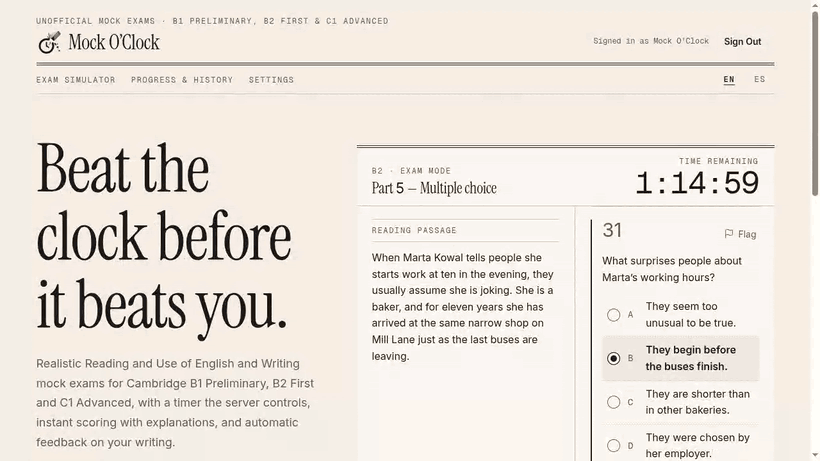
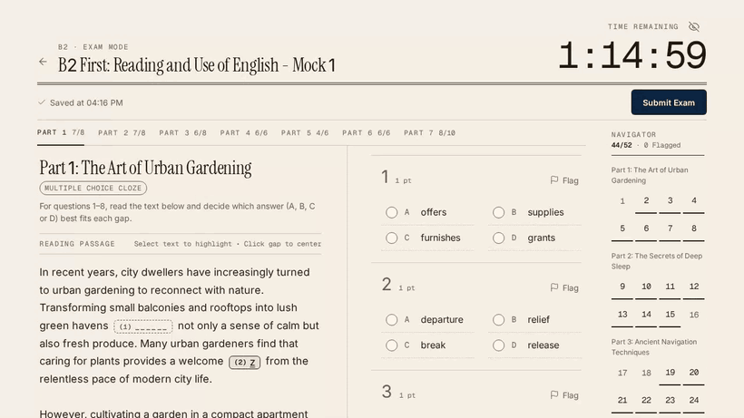
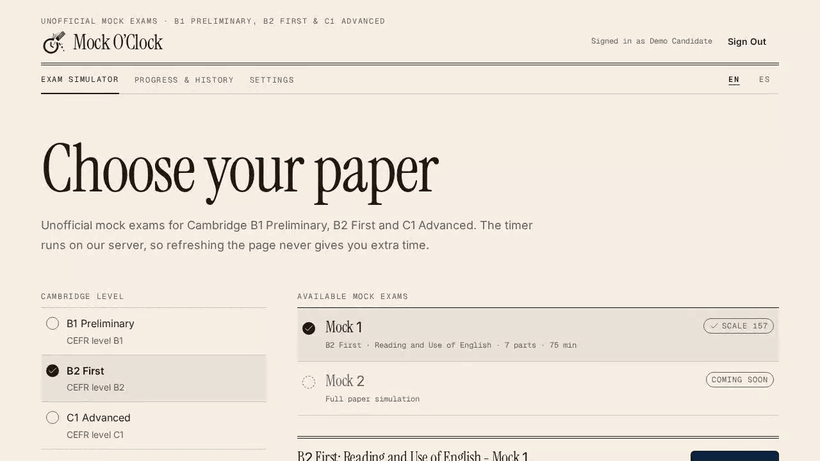
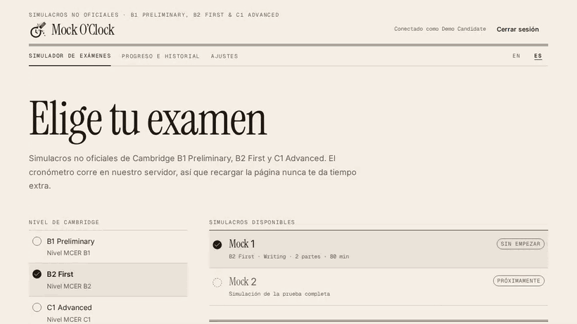
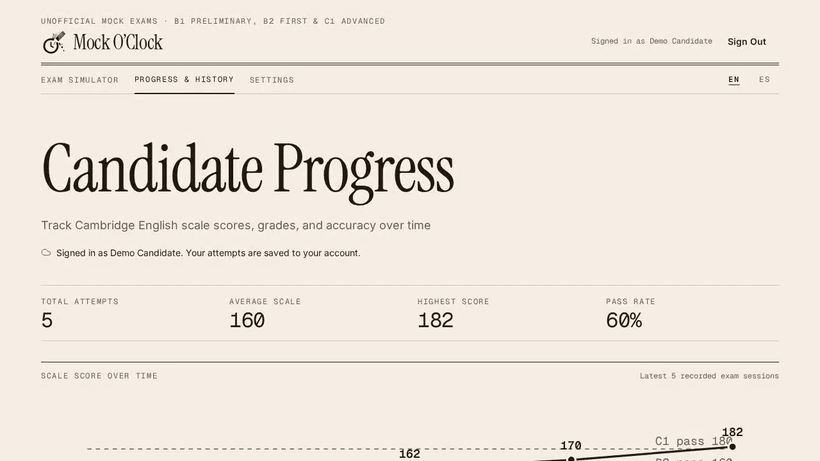
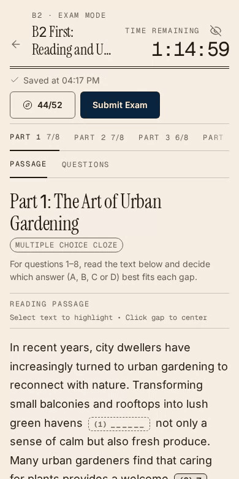
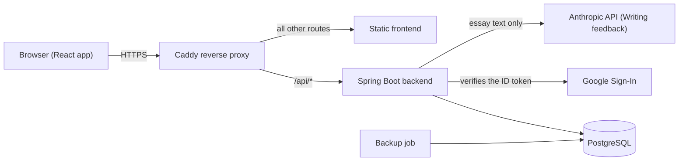

# Mock O'Clock: app showcase

Mock O'Clock is an unofficial mock exam simulator for the Reading and Writing papers of Cambridge B1 Preliminary, B2 First and C1 Advanced. It is live at [mockoclock.co.uk](https://mockoclock.co.uk). This repository shows the app in action and explains how I built and run it; it holds no source code.

> **Open the diagrams in Chrome.** The diagrams in this repository are written in Mermaid, and in some other browsers they appear as raw code instead of a drawing.

## What it is and why I built it

A candidate who practises on paper has no real clock, and the clock is the hardest part of a Cambridge exam. For that reason, the timer in Mock O'Clock belongs to the server, in the same way as the invigilator in a real exam hall owns the stopwatch. Refreshing the page or changing the device never gives extra time.

I chose one Spring Boot backend, one React app and one PostgreSQL database on a single VPS, because I am the only developer and a microservices setup would cost more time than it would save. The cost of that choice is that the whole site depends on one machine, which I describe in the [architecture notes](docs/ARCHITECTURE.md).

At the moment the live site serves six sample exams. A larger bank of exams is the next step.

## The app in six recordings

Every recording shows the real interface driven by a script against the live site. Nothing is mocked: accounts, attempts, scores and the AI feedback are real. The accounts used were throwaway ones, deleted after recording. The name next to "Signed in as" is the one Google gives the account, which is why it differs between recordings.

### 1. Landing page, in English and Spanish

The landing page shows a real preview of the exam screen, and a language switch moves to the same page in the other language (`/` and `/es`). Each language has its own title, canonical link and `hreflang`. The exam itself stays in English, as in the real exam.

### 2. A timed Reading exam, from first answer to results

The exam is picked up half done: I flag a question, jump between parts, answer a blank one, review what is unanswered and submit. The results give an estimated Cambridge scale score, a score per part, and for every question the correct answer and the reason.

### 3. Practice mode: instant feedback, checked by the server

Practice has no timer. When the candidate presses "Check answer", the server returns the verdict and the explanation for that one question. The answer key never travels with the exam, so nobody can read it from the developer tools of the browser.

### 4. Writing, marked by an AI, with the feedback in Spanish

An essay is typed live, with a word count against the official range, and then submitted. The AI scores it from 0 to 5 on Content, Communicative Achievement, Organisation and Language, and it quotes corrections from the candidate's own text. The page always says that the result is an estimate and not an official score. The recording is sped up, because the AI takes about ten seconds.

### 5. Progress over time

Every attempt of the account is charted against the pass marks of the three levels, with the full list below. The limitation is that the chart only makes sense after a few attempts.

### 6. On a phone: the passage keeps its place

On a small screen the passage and the questions are tabs that share the page. Tapping a gap in the passage jumps to its question, and going back returns to exactly where the reading stopped.

## How it fits together

For the request path, the browser always talks to a single origin. Caddy receives every request, sends `/api/*` to the backend and everything else to the static frontend.

The full explanation of the exam flow, the data I store and the deployment is in [docs/ARCHITECTURE.md](docs/ARCHITECTURE.md).

## Monitoring

All the monitoring lives in Grafana, behind a single login, and it runs on the same server as the site. It covers uptime, errors, speed, server health, product usage, logs and visitor statistics, with alerts for when something breaks. The details are in [docs/MONITORING.md](docs/MONITORING.md).

Dashboard screenshots will follow in a later version of this repository.

## Where the tests run

The checks of every change run in a virtual machine at my house, registered in GitHub as a self-hosted runner, because the free GitHub Actions minutes were not enough for me. GitHub still keeps the history and shows the results on each pull request. The decision, the problems I found and the limits are in [docs/CI-AND-INFRASTRUCTURE.md](docs/CI-AND-INFRASTRUCTURE.md).

## Privacy by design

An account stores only a random identifier, the opaque identifier that Google assigns to the Google account, and the creation date. I never store a name, an email address or a photo. The name shown next to "Signed in as" is read from the Google sign-in in the visitor's own browser, and it never reaches my server. Guests can use the Reading exams without an account, and an attempt made without an account is linked only to a random identifier.

## What is next

The main limitation today is the size of the exam bank. After that, I want to add an uptime check that runs outside the server, so that an outage of the main machine does not silence the alerts, and I want to add the dashboard screenshots to this repository. For the tests, I want to add a second runner so that two jobs can run at the same time.

## Contact

I am Ezequiel Farioli, the only developer of Mock O'Clock. You can find me on [LinkedIn](https://www.linkedin.com/in/zeke-farioli).
