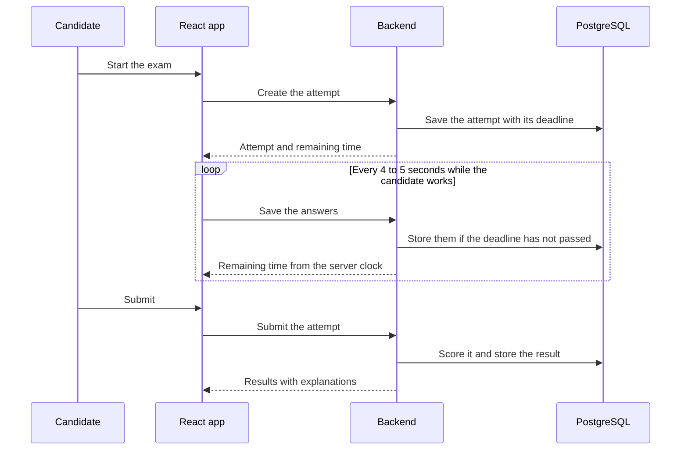
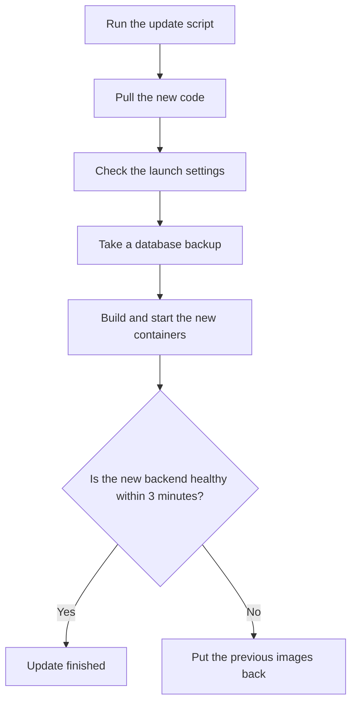

# Architecture notes

> **Open this page in Chrome.** The diagrams are written in Mermaid, and in some other browsers they appear as raw code instead of a drawing.

## Stack and why

The backend is Spring Boot 3.5 on Java 21, with PostgreSQL 16 and Flyway for the migrations. The frontend is a React app built with Vite. Caddy sits in front of both and handles HTTPS, and everything runs with Docker Compose on one Contabo VPS with 8 GB of memory.

I chose this stack because it is the one I know best, and because a single developer needs a system that one person can deploy, back up and fix. A separate service for each part would have added network calls, deployments and failure modes without any benefit at this size. The cost is that a failure of the VPS takes down everything at once.

## What happens during a timed exam

The server owns the clock. When the candidate starts an exam, the backend saves the attempt with a deadline, and from that moment every request is compared with the server time and not with the time in the browser.

For the countdown on screen, the browser counts down second by second so that the timer looks smooth, and it corrects itself with the remaining time that the server returns on every save. A tab with a wrong clock therefore fixes itself on the next save. The browser also keeps a local copy of the answers, so a refresh or a lost connection does not lose the work.

The limitation is that a candidate who loses the connection for a long time still loses that time, because the server clock does not stop.

## Practice mode and the answer key

In practice mode the candidate presses "Check answer" and the server returns the verdict and the explanation for that single question. The full answer key never travels with the exam to the browser. In the same way as a teacher who marks the answer without handing over the whole mark scheme, the server reveals one answer at a time.

## Writing feedback

When a candidate submits a Writing exam, the backend sends the essay and the task to the Anthropic API, without the account identifier. The AI scores the four official criteria from 0 to 5 and quotes corrections from the candidate's own text. If the AI fails, a built-in checker on my own server takes over, so the candidate always gets a result.

I decided on a monthly limit for Writing attempts per account, because every attempt costs money. The limit is a setting and can be changed without a new deployment.

## Data, retention and privacy

The database stores accounts, attempts, answers and results. An account contains only a random identifier, the identifier that Google assigns to the Google account and the creation date; I do not store the name, the email address or the photo.

| Data | Kept for |
| --- | --- |
| Attempts made without an account | 90 days |
| Account attempts that were never submitted | 90 days |
| Submitted attempts of an account | Until the account is deleted |
| Backups | 14 days |

A candidate can download all the stored data as a JSON file and delete the account, which removes every attempt, answer and result at once. The weak point is the essay text, because candidates may type personal details into it; for that reason the privacy notice asks them not to.

## Protection against abuse

The API limits the number of requests per client address: 10 sign-ins per minute, 20 new attempts per minute, 10 submissions per minute and 600 of everything else. When a client exceeds a limit, the backend answers with a `429` status and a `Retry-After` header. The counters live in memory, so they reset when the backend restarts.

## Deploying without losing data

An update follows a fixed order, and each step protects the previous one.

The backend restarts for about a minute during an update, so I check that nobody is in the middle of a timed exam before I redeploy. A planned improvement is to refuse the restart automatically when an exam is in progress.

## Tests

The backend has unit tests and integration tests that run against a real PostgreSQL in a container (Testcontainers). The frontend has component tests with React Testing Library and mocked network calls, plus end-to-end tests with Playwright that drive the real interface. GitHub Actions runs all of them on every change, on a runner that I host in a virtual machine at home (see [where the tests run](CI-AND-INFRASTRUCTURE.md)). The limitation is that there is no staging copy of the site, so these tests are the only safety net before a change reaches the live site.
