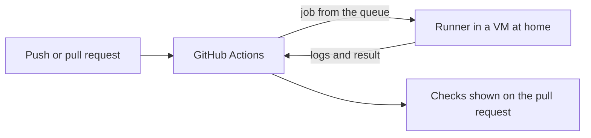

# Where the tests run

> **Open this page in Chrome.** The diagram is written in Mermaid, and in some other browsers it appears as raw code instead of a drawing.

## Why I moved the checks to a machine at home

Every change to Mock O'Clock runs through the same five checks on GitHub Actions: the backend tests, the frontend checks, a repository hygiene check, a scan for vulnerable dependencies and leaked secrets, and the end-to-end tests that drive the real interface in a browser. GitHub gives a private repository 2,000 free minutes a month, and I used them up. From that moment the checks could not start, and a pull request without a green check is a pull request I do not trust.

I had two options: pay for more minutes or run the checks on a machine I already own. I chose the second one because I had just set up a powerful desktop at home, and because I am the only person who pushes to the repository.

Before moving anything, I cut the waste. A change that touches only documentation no longer runs the checks, Dependabot opens fewer pull requests, and the end-to-end job is the longest one, so it ran only on `main` and on pull requests that I labelled for it. The limitation is that a cheaper schedule only delays the problem; it does not remove it.

## How it is connected

The checks run in a virtual machine on my desktop at home. The machine is registered in GitHub as a self-hosted runner, so GitHub still decides when a job starts, still stores the history of every run, and still shows the result on the pull request. For the person who reads the pull request, nothing changed. For GitHub, my runner is one more machine that picks jobs from the queue.

In the same way as a delivery company can use its own vans or hire another company's, the workflow files only say what has to be done and not who does it. A single repository variable, `CI_RUNS_ON`, chooses the machine. When it holds the label of my runner, the jobs go home; when I delete it, they go back to GitHub's runners, with no change in any workflow file.

The virtual machine is Ubuntu Server 26.04 under KVM, with 6 virtual processors and 6 GB of memory, and it has no desktop environment because Playwright's browser needs libraries and not a screen. I tried Debian 13 first. It worked, but it needed three patches (the `docker compose` plugin, a Python packaging restriction and the list of browser dependencies), while Ubuntu needed none. Ubuntu was also the sensible choice because `ubuntu-latest`, the image the workflows were written for, is Ubuntu as well.

The limitation is that the runner depends on my machine being on. If it is off while the variable is set, the jobs wait for a runner that never arrives, and I have to delete the variable.

## What the move taught me

The hardest problem was a failure that GitHub's runners can never show. The end-to-end job starts containers with Docker Compose, and those containers write files into the workspace as the root user. On GitHub every job gets a fresh machine, so nobody notices. On my runner, which is reused, the next job could not check out the code because it had no permission to delete those files.

I fixed it on the runner and not in the workflows. A small hook runs before and after every job: it gives the workspace back to the runner user and removes leftover containers, networks and volumes. I think this was the right place, because the workflows stay identical on both kinds of runner, and that is the whole point of the variable.

There is also a benefit I did not plan. Running at home costs no minutes, so the end-to-end tests now run on every pull request and not only on `main`. A change that breaks only that test is found before the merge. On top of that, the Docker, Gradle and npm caches stay warm between jobs, which saves time on every run.

The cost is speed. The first full run on the virtual machine took about five to six minutes, while GitHub's parallel runners take about four, because my runner does one job at a time.

## What it does not do

The runner is persistent, which means it is registered once and reused for every job. An ephemeral runner, created for one job and destroyed afterwards, would be cleaner, but it needs a GitHub token inside the machine where the code runs, and I preferred not to put one there. This setup is acceptable only because the repository is private and I am its only user; I would not register such a runner for a public repository or for one that accepts pull requests from strangers.

My next step is a second runner so that two jobs can overlap. The end-to-end job binds a fixed port and uses fixed container names, so it will need its own machine or its own Compose project name first.
