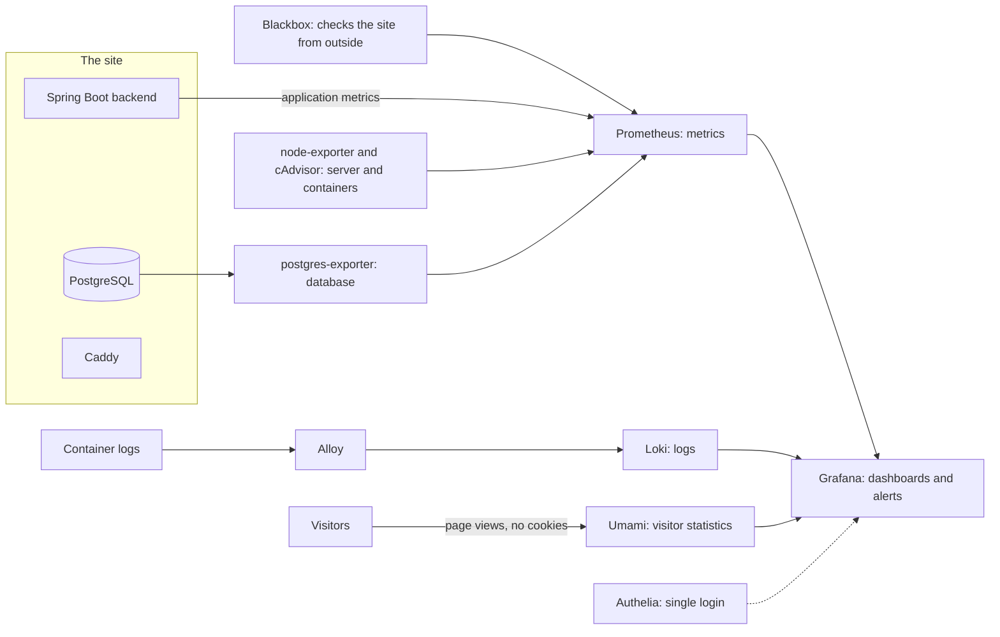

# Monitoring

> **Open this page in Chrome.** The diagram is written in Mermaid, and in some other browsers it appears as raw code instead of a drawing.

## What it covers

Grafana holds all the monitoring of Mock O'Clock. It runs on the same server as the site, it costs nothing, and it is reached through one address and one login. Its job is to answer four questions: is the site up, is it healthy, how is it used, and what did it write when something went wrong.

## The pieces behind Grafana

Grafana is only the screen. Behind it, each tool collects one kind of data, and a single login service (Authelia) protects every address.

## The dashboards

| Dashboard | What I look at there |
| --- | --- |
| Overview | Whether the site and its health check are up, the days left on the certificate, response time, errors, slow endpoints, and the state of the server and the database |
| Product | Attempts started and finished, guests against accounts, how Writing was graded, sign-ins and limits reached; it contains counts only, never personal data |
| Visitors | Where visitors come from, their country, device and browser, and how long they stay |
| Logs | What the containers wrote, with a search box for a specific error; logs are kept for 14 days |

For example, if the Product dashboard shows that the AI feedback keeps falling back to the built-in checker, I know to check the API key and its balance before candidates notice.

## Alerts

Twelve rules are configured. They cover the site being down, the health check failing, the backend not reporting metrics, a certificate that is about to expire, server errors, slow responses, failures of the AI grading, many rate-limit hits, a disk that is almost full, high memory, high CPU and an exhausted database pool.

## Cost and limits

The whole layer uses around 1 GB of the 8 GB of the server, and metrics are kept for 15 days. I decided to keep it on the same machine because a second server would add a monthly cost that the project cannot justify yet. The consequence is that if the machine goes down, the monitoring goes down with it.

Next steps are an uptime check that runs outside the server and the dashboard screenshots, which will be added to this repository.
